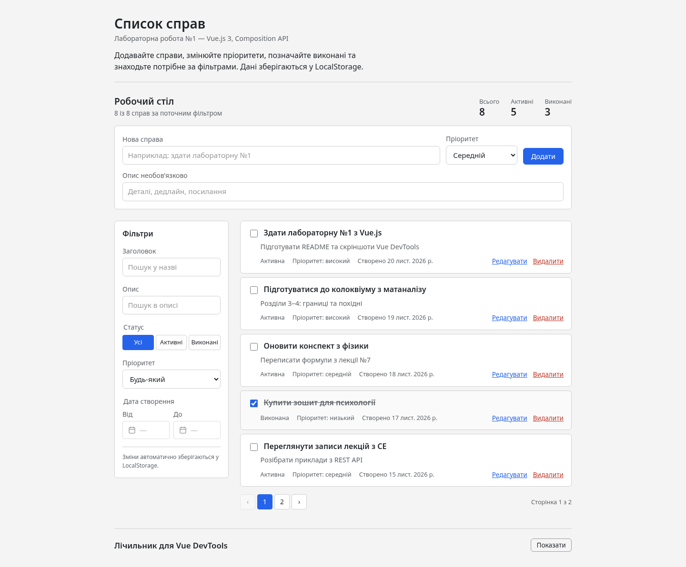
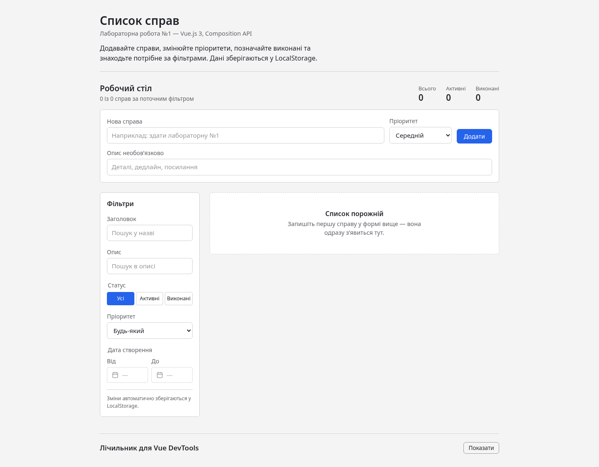
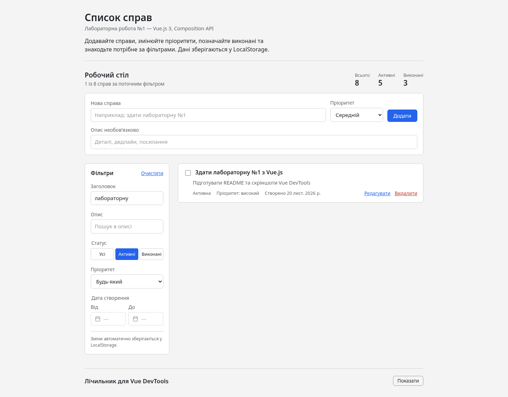
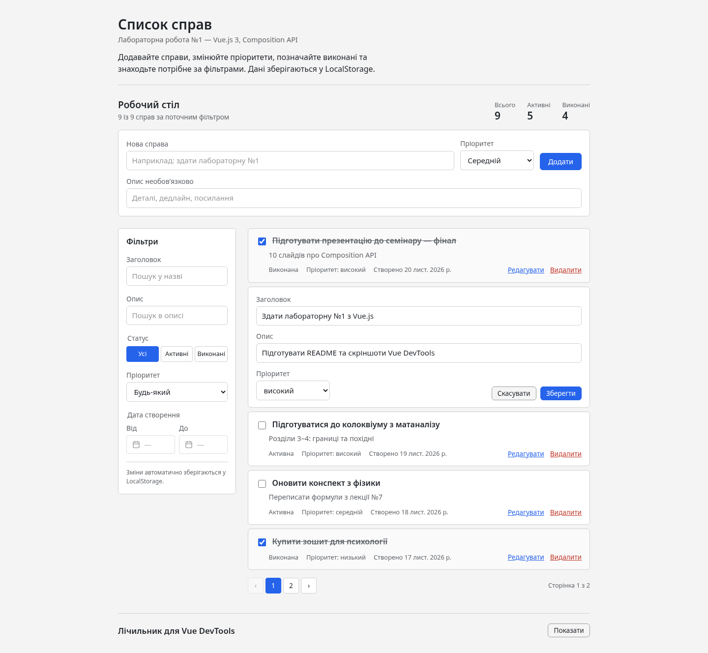
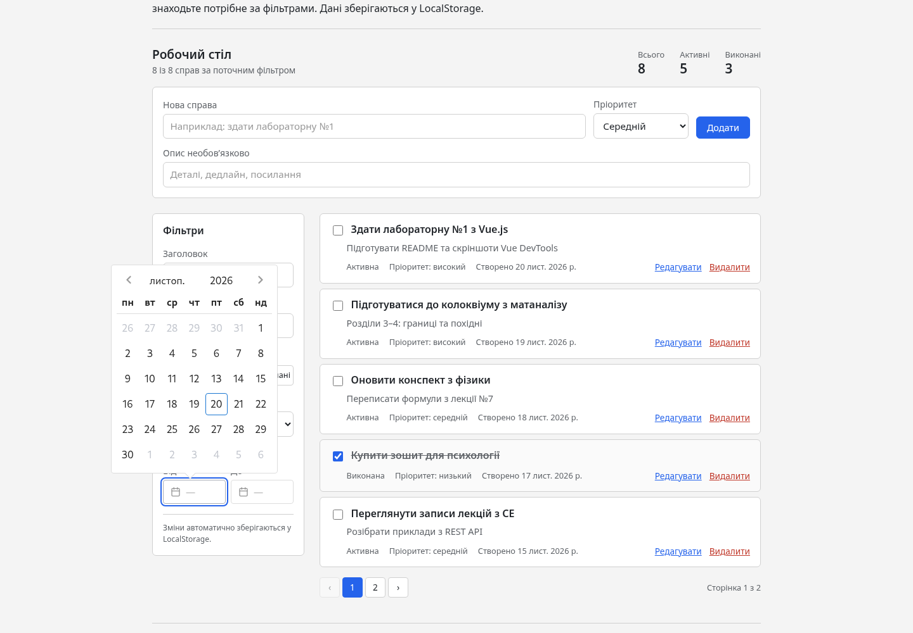

# Лабораторна робота №1 — Vue.js 3 (Composition API)
To-Do застосунок на Vue 3, який демонструє реактивний стан, похідні значення, спостерігачі, директиви та збереження даних у LocalStorage. Проєкт створено на Vite, залежності встановлюються через pnpm.



## Запуск проєкту
Потрібні Node.js 20.19+ (або 22.12+) і pnpm.

```bash
cd lab1
pnpm install
pnpm dev
```

Vite запустить застосунок на http://localhost:5173. Vue DevTools відкривається комбінацією `Alt+Shift+D`.

> У `pnpm-workspace.yaml` дозволено postinstall-скрипт пакета `vue-demi` (`pnpm 10+` за замовчуванням блокує такі скрипти). Це потрібно для коректної роботи `@vuepic/vue-datepicker`.

## Функціональність
- Додавання справ із назвою, описом і пріоритетом. Порожня назва не додається - показується повідомлення про помилку.
- Перемикання статусу між `active` і `done` одним кліком на чекбокс.
- Видалення справи.
- Редагування назви, опису та пріоритету прямо в картці (кнопка «Редагувати»). `Esc` скасовує редагування.
- Обчислювані лічильники «Всього», «Активні», «Виконані» на основі `computed`.
- Збереження списку в LocalStorage: читання під час старту, запис на кожну зміну через `watch` із `deep: true`.
- Фільтрація за назвою, описом, статусом, пріоритетом і діапазоном дати створення (`від`/`до`). Для вибору дати використовується `@vuepic/vue-datepicker` з українською локаллю.
- Скидання фільтрів однією кнопкою «Очистити».
- Пагінація: по 5 справ на сторінку, номери сторінок і переходи «назад/вперед».
- Порожні стани для випадків «список порожній» і «нічого не знайдено».
- Адаптивна верстка, видимий фокус, підтримка `prefers-reduced-motion`.


## Реактивність: ref, reactive, computed, watch
| API        | Файл                                        | Призначення                                                                                                                                                   |
| ---------- | ------------------------------------------- | ------------------------------------------------------------------------------------------------------------------------------------------------------------- |
| `ref`      | [App.vue](src/App.vue)                      | `counter` для демонстрації у Vue DevTools, `showCounterDemo` для показу панелі                                                                                |
| `ref`      | [TodoApp.vue](src/components/TodoApp.vue)   | `todos` — джерело істини, `page` — поточна сторінка пагінації                                                                                                 |
| `ref`      | [TodoForm.vue](src/components/TodoForm.vue) | `error` для повідомлення валідації                                                                                                                            |
| `ref`      | [TodoItem.vue](src/components/TodoItem.vue) | `isEditing`, `error` для режиму редагування                                                                                                                   |
| `reactive` | [TodoApp.vue](src/components/TodoApp.vue)   | об’єкт `filters` з усіма умовами фільтрації                                                                                                                   |
| `reactive` | [TodoForm.vue](src/components/TodoForm.vue) | `draft` — чернетка нової справи                                                                                                                               |
| `reactive` | [TodoItem.vue](src/components/TodoItem.vue) | `draft` — чернетка під час редагування                                                                                                                        |
| `computed` | [TodoApp.vue](src/components/TodoApp.vue)   | `totalCount`, `activeCount`, `doneCount`, `filteredTodos`, `totalPages`, `pagedTodos`, `pageNumbers`, `hasActiveFilters`                                      |
| `watch`    | [TodoApp.vue](src/components/TodoApp.vue)   | `todos` із `deep: true` записує зміни в LocalStorage; `filters` із `deep: true` скидає сторінку на першу; `totalPages` коригує номер сторінки після видалення |

## Директиви: де і як використані
| Директива                       | Приклади в проєкті                                                                                                                                                                                                                                       |
| ------------------------------- | -------------------------------------------------------------------------------------------------------------------------------------------------------------------------------------------------------------------------------------------------------- |
| `v-model`                       | Поля нової справи та вибору пріоритету ([TodoForm.vue](src/components/TodoForm.vue)); пошук за назвою/описом, статус, пріоритет, дати ([TodoApp.vue](src/components/TodoApp.vue)); поля inline-редагування ([TodoItem.vue](src/components/TodoItem.vue)) |
| `v-bind` / `:`                  | `:class` для виконаних справ, активної кнопки статусу та поточної сторінки; `:checked` для чекбокса; `:key` у списках; `:aria-*`, `:disabled`, `:aria-pressed`, `:max-date` і `:min-date` у datepicker                                                   |
| `v-on` / `@`                    | `@submit.prevent` на формах; `@click` на кнопках і сторінках; `@change` на чекбоксі; `@keydown.esc` для скасування редагування                                                                                                                           |
| `v-for`                         | Список справ `pagedTodos` (через `TodoItem`), варіанти пріоритетів, варіанти статусу, номери сторінок                                                                                                                                                    |
| `v-if` / `v-else-if` / `v-else` | Режим редагування проти режиму перегляду; два порожні стани; повідомлення про помилки; кнопка «Очистити»; пагінація                                                                                                                                      |
| `v-show`                        | Панель «Лічильник для Vue DevTools» в [App.vue](src/App.vue)                                                                                                                                                                                             |
| `v-for` + `<TransitionGroup>`   | Плавна поява/переміщення карток у списку                                                                                                                                                                                                                 |

## Скріншоти
Порожній стан:


Фільтрація:


Редагування справи:


Вибір дати:

