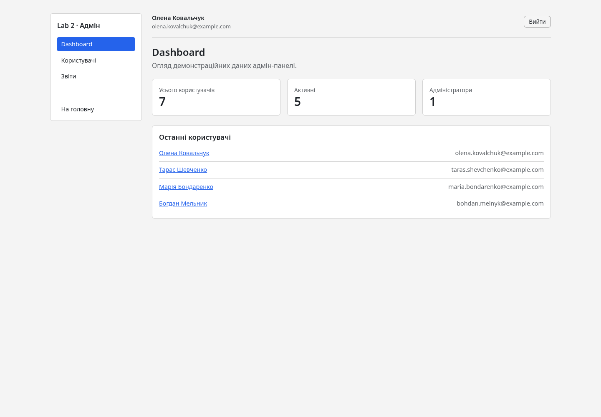
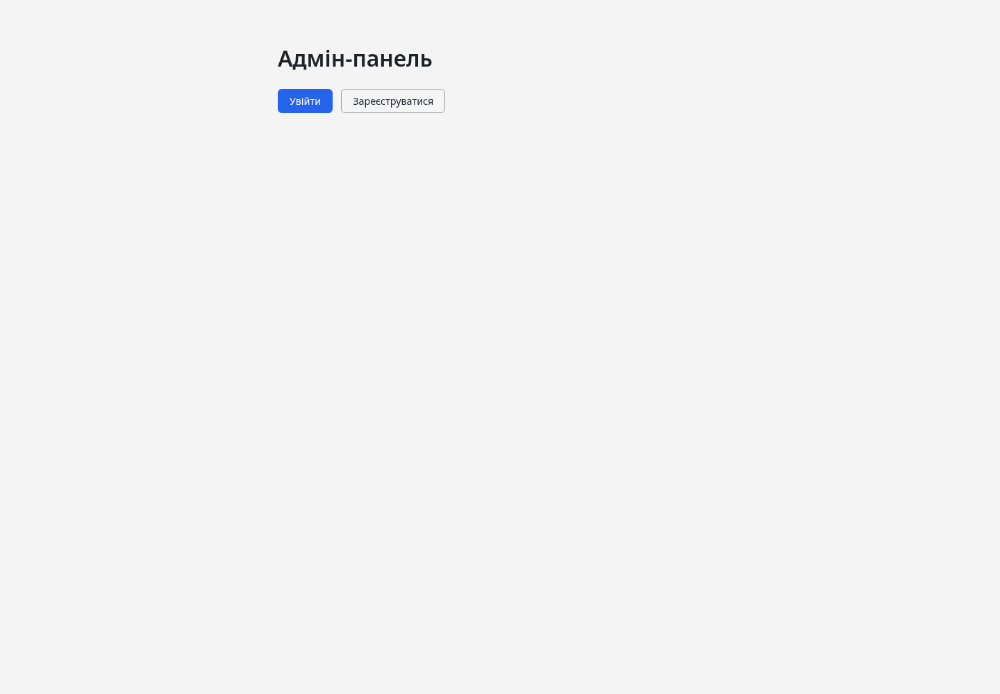
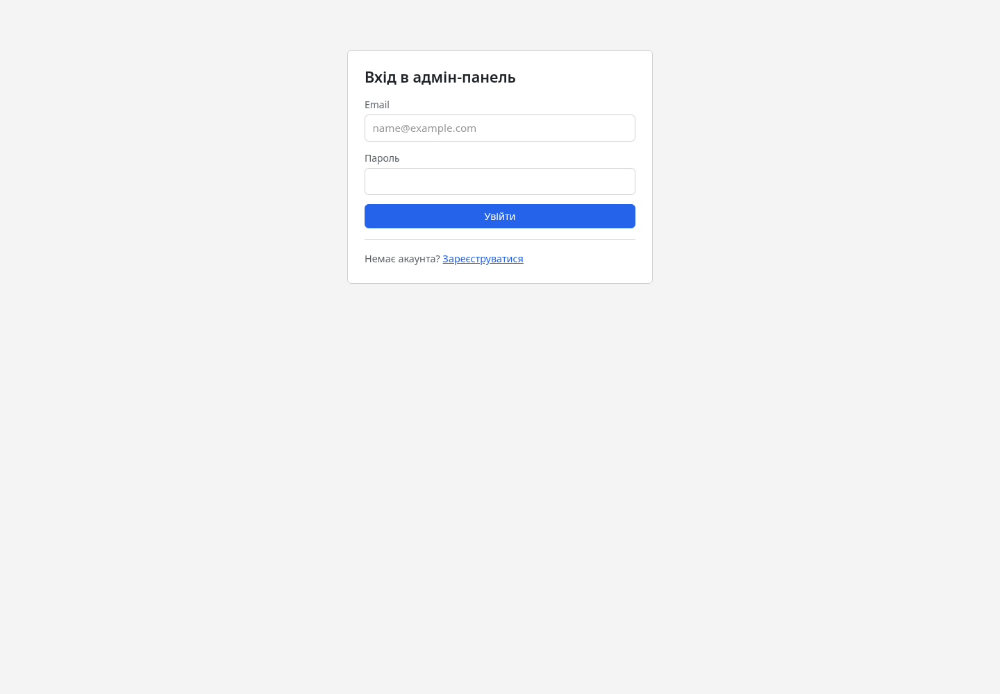
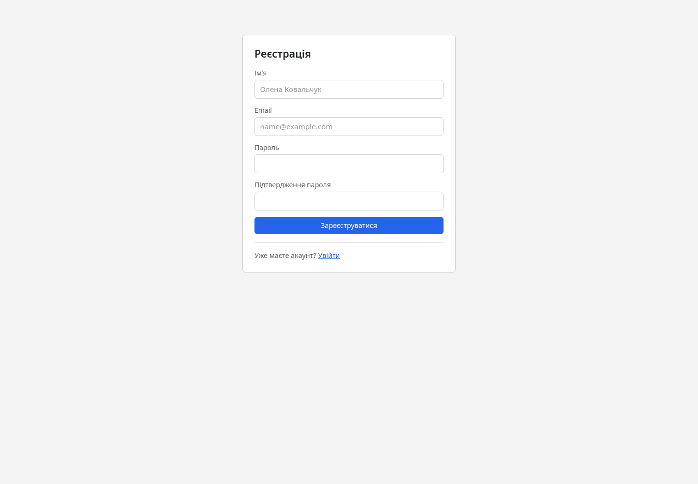
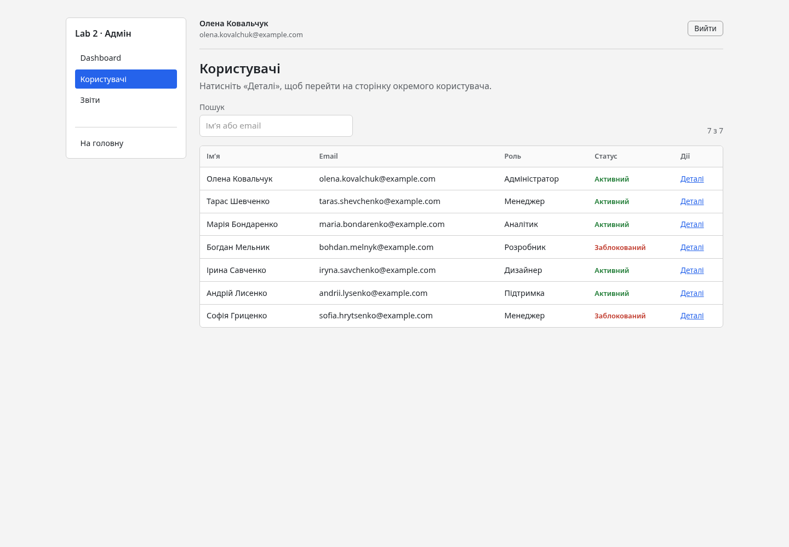
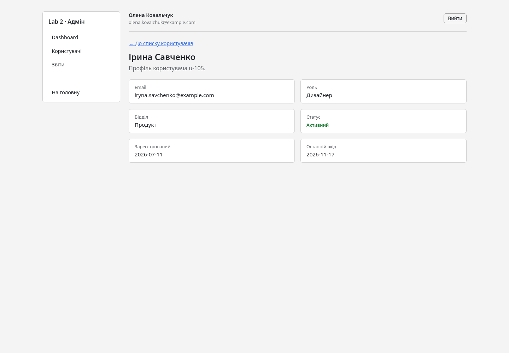
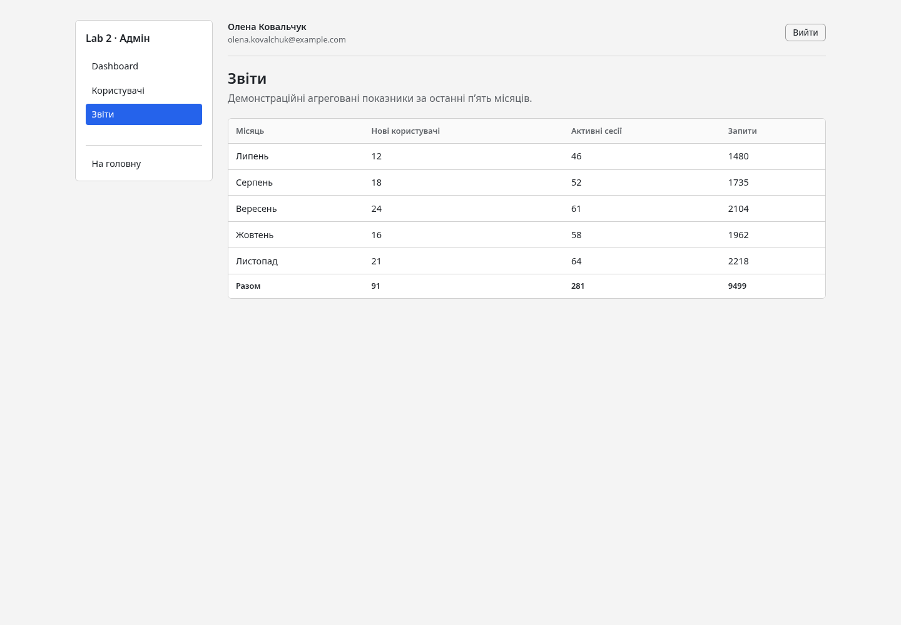
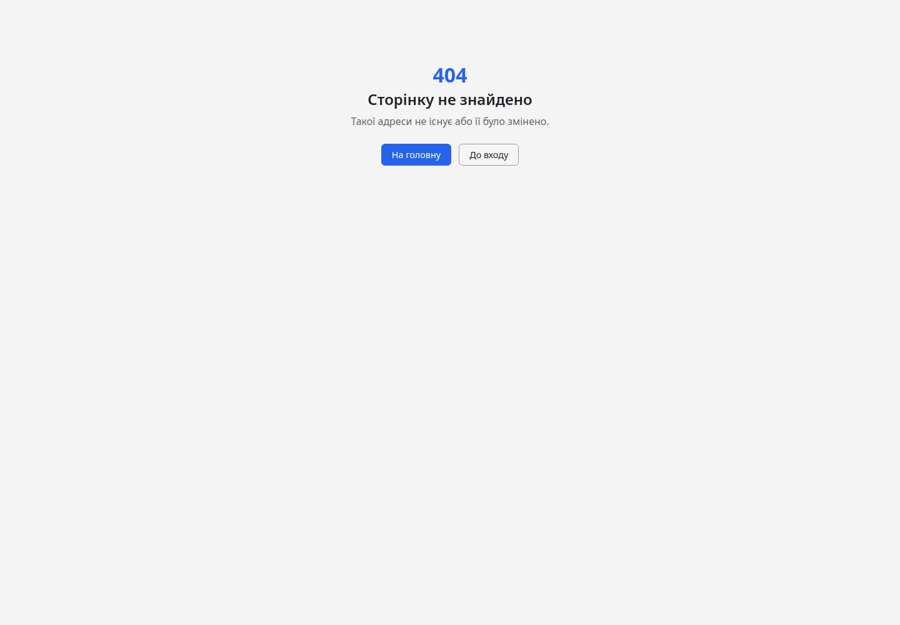

# Лабораторна робота №2 - Vue Router та взаємодія між компонентами

Прототип адмін-панелі з імітацією автентифікації на Vue 3 і Vue Router 4. Застосунок має публічні сторінки, захищений розділ `/admin` із lazy-loaded вкладками Dashboard / Користувачі / Звіти та навігаційний guard. Проєкт створено на Vite, залежності встановлюються через pnpm.



## Запуск проєкту

Потрібні Node.js 20.19+ (або 22.12+) і pnpm.

```bash
cd lab2
pnpm install
pnpm dev
```

Vite запустить застосунок на http://localhost:5173. Для входу підійде будь-який коректний email і пароль від 6 символів.

## Функціональність

- Публічні сторінки `/`, `/login`, `/register`.
- Перехід у `/admin` лише після входу: guard перенаправляє на `/login` із параметром `redirect`, а після входу повертає на початкову адресу.
- Валідація форм: формат email, мінімальна довжина пароля, збіг підтвердження пароля, обов’язкове ім’я.
- Адмін-панель із навігацією Dashboard / Користувачі / Звіти та даними авторизованого користувача.
- Dashboard з обчислюваними показниками та останніми користувачами.
- Список користувачів із пошуком і переходом на сторінку окремого користувача `/admin/user/:id`.
- Звіти з таблицею демонстраційних показників і підсумками.
- Сесія зберігається в LocalStorage (`vuejs-labs-2026:lab2:session`); кнопка «Вийти» її очищує.
- Catch-all маршрут показує сторінку 404.

## Маршрути

| Шлях               | Ім’я          | Доступ              | Компонент        | Примітка                   |
| ------------------ | ------------- | ------------------- | ---------------- | -------------------------- |
| `/`                | `home`        | `meta.public`       | `HomeView`       | Головна сторінка           |
| `/login`           | `login`       | `meta.public`       | `LoginView`      | Форма входу                |
| `/register`        | `register`    | `meta.public`       | `RegisterView`   | Форма реєстрації           |
| `/admin`           | -             | `meta.requiresAuth` | `AdminLayout`    | Редірект на `dashboard`    |
| `/admin/dashboard` | `dashboard`   | `requiresAuth`      | `DashboardView`  | Lazy-loaded                |
| `/admin/users`     | `users`       | `requiresAuth`      | `UsersView`      | Lazy-loaded                |
| `/admin/user/:id`  | `user-detail` | `requiresAuth`      | `UserDetailView` | Lazy-loaded, `props: true` |
| `/admin/reports`   | `reports`     | `requiresAuth`      | `ReportsView`    | Lazy-loaded                |
| `/:pathMatch(.*)*` | `not-found`   | `meta.public`       | `NotFoundView`   | Сторінка 404               |

## Взаємодія між компонентами

| Механізм                  | Де використано                                                                        | Що робить                                                              |
| ------------------------- | ------------------------------------------------------------------------------------- | ---------------------------------------------------------------------- |
| `props` / `emits`         | `LoginView` → `LoginForm`, `RegisterView` → `RegisterForm`, `UsersView` → `UserTable` | `:submitting` / `@submit`, `:users` / `@open` - дані вниз, події вгору |
| `v-model` / `defineModel` | `BaseInput`                                                                           | `const model = defineModel()`; поля форм підключені через `v-model`    |
| `provide` / `inject`      | `App.vue` → `AdminLayout`, `HomeView`                                                 | `authKey` з даними користувача; умовний показ шапки адмінки та кнопок  |
| Слоти                     | `AuthShell`                                                                           | named-слоти `title`, `footer` і default-слот для форми                 |

## Скріншоти

Головна сторінка:



Вхід:



Реєстрація:



Користувачі:



Профіль користувача:



Звіти:



Сторінка 404:


