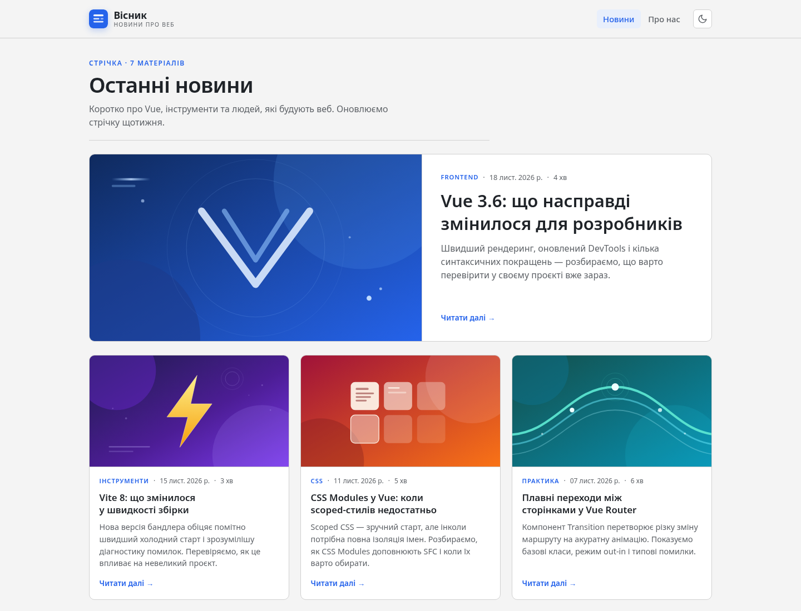
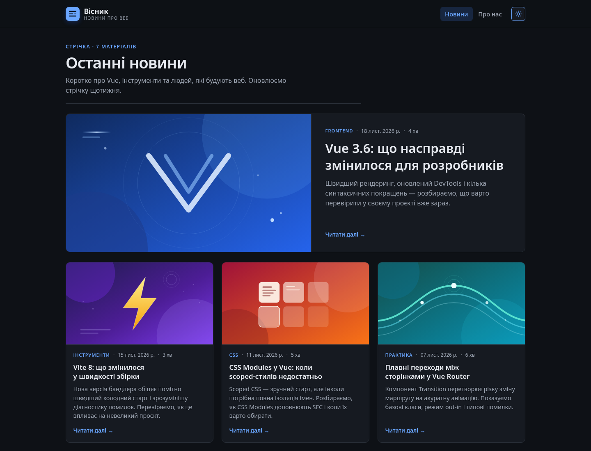
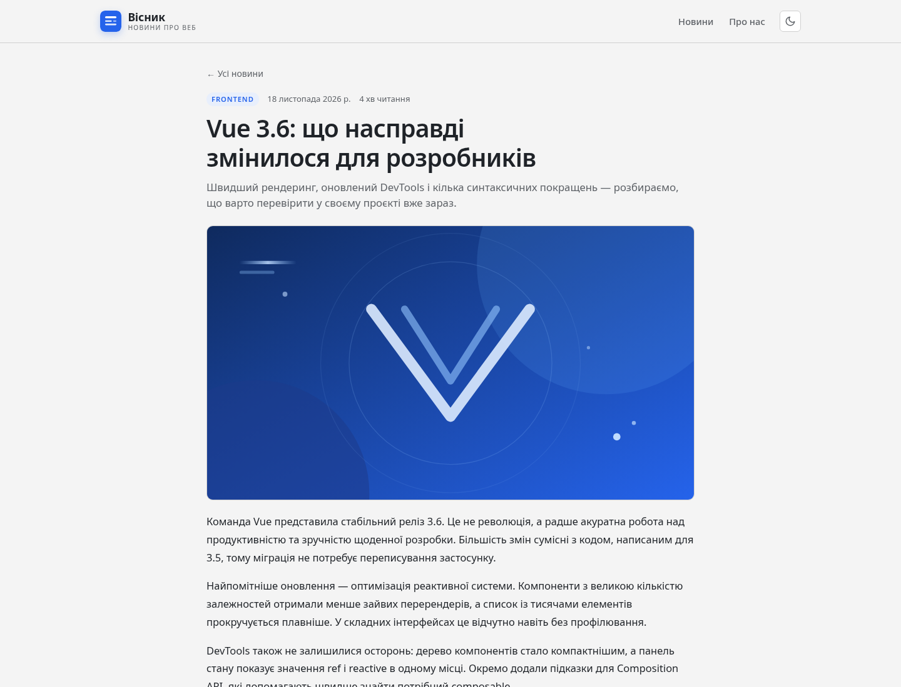
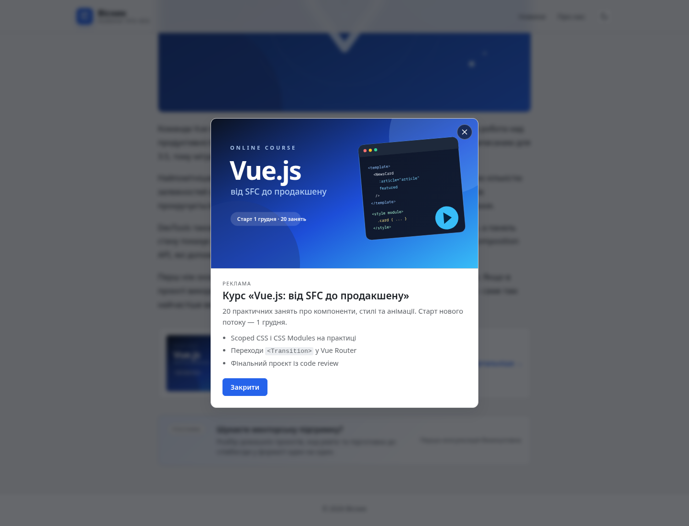
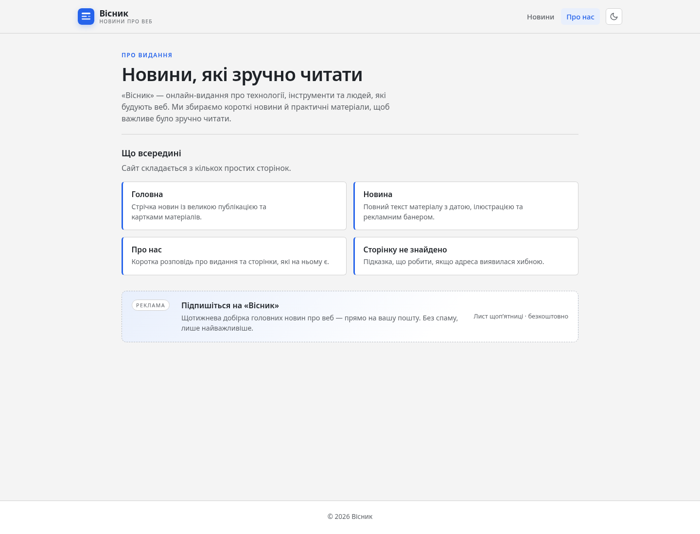
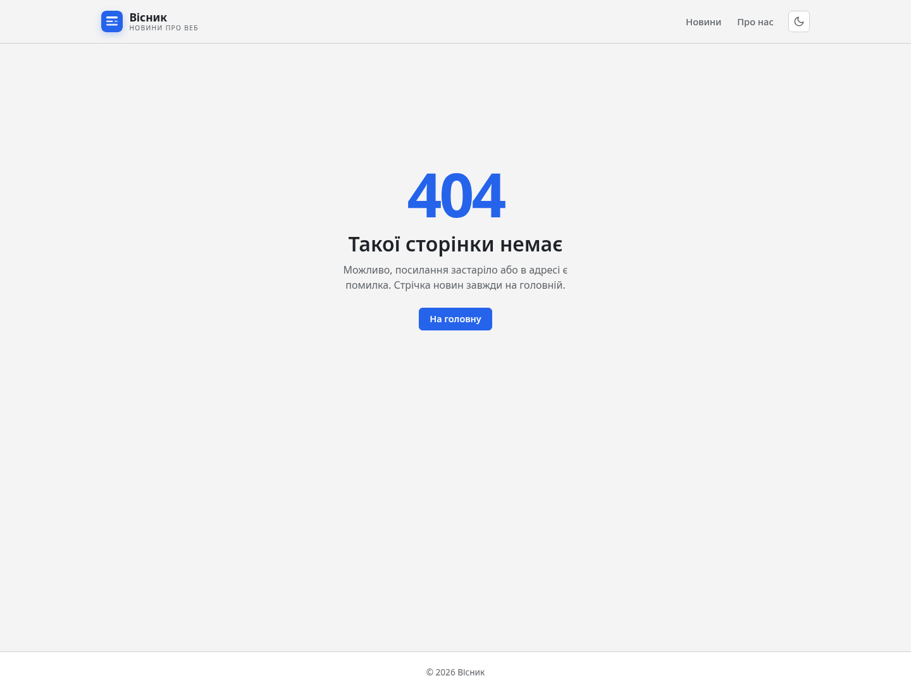
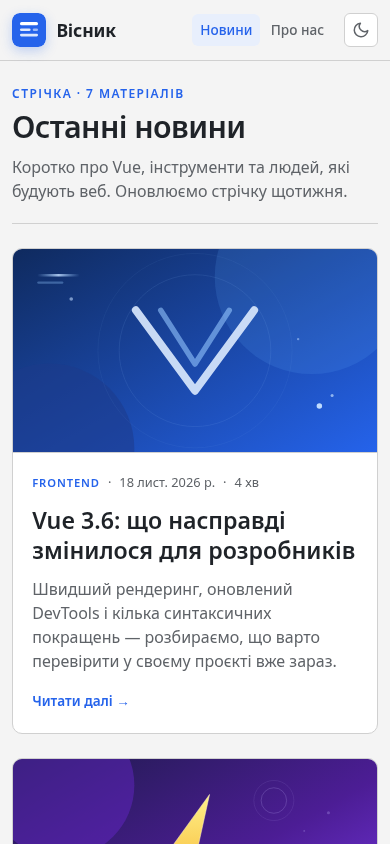

# Лабораторна робота №3 - Стилізація компонентів у Vue.js

Прототип новинного сайту на Vue 3, Vue Router 4 і Vite. Проєкт демонструє scoped CSS, CSS Modules, тему Light/Dark на CSS-змінних, анімації переходів між сторінками та рекламні слоти з модальним вікном.



## Запуск проєкту

Потрібні Node.js 20.19+ (або 22.12+) і pnpm.

```bash
cd lab3
pnpm install
pnpm dev
```

## Скріншоти

Темна тема:



Сторінка новини:



Модальне вікно реклами:



Сторінка «Про нас»:



Сторінка 404:



Мобільна верстка:



## Висновки

- `scoped` у Vue SFC - найшвидший спосіб локалізувати стилі сторінки: достатньо додати атрибут, і компілятор сам додасть до селекторів унікальний ідентифікатор. Для верстки окремих екранів цього зазвичай достатньо.
- CSS Modules доцільні для повторно використовуваних блоків, як-от картка новини: імена класів хешуються, конфлікти між компонентами стають неможливими, а сам стиль лежить у файлі `.module.css` поруч із компонентом. Vite підтримує їх без додаткової конфігурації.
- Поєднання глобальних CSS-змінних зі scoped-стилями та модулями дає передбачуваний порядок каскаду: змінні й reset - глобально, конкретна верстка - локально. Завдяки цьому тема перемикається в одному місці, без дублювання кольорів у компонентах.
- Анімація `<RouterView>` вимагає єдиного кореневого елемента в кожній сторінці та змінного ключа. Режим `out-in` дає охайний перехід без накладання макетів, а `prefers-reduced-motion` зберігає доступність.
- Модальне вікно краще виносити через `<Teleport>`, керувати блокуванням прокрутки та повертати фокус на кнопку, що його відкрила.
