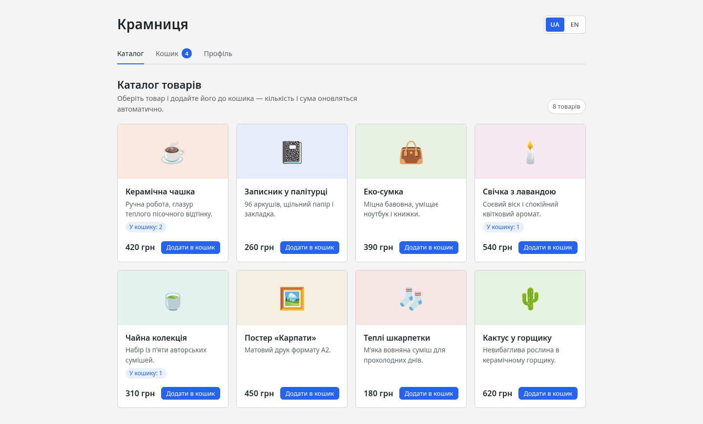
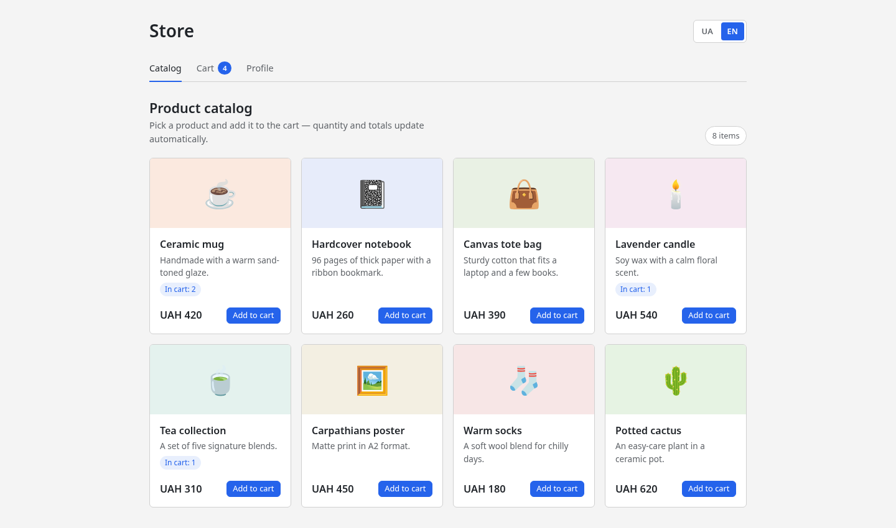
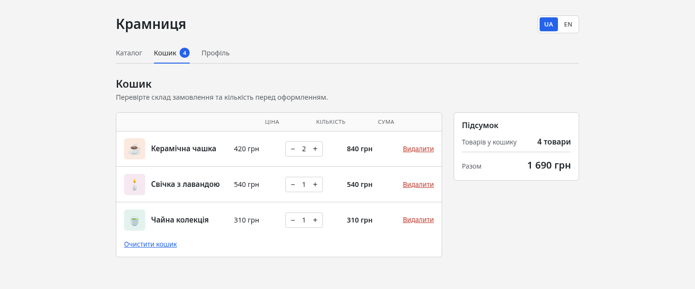
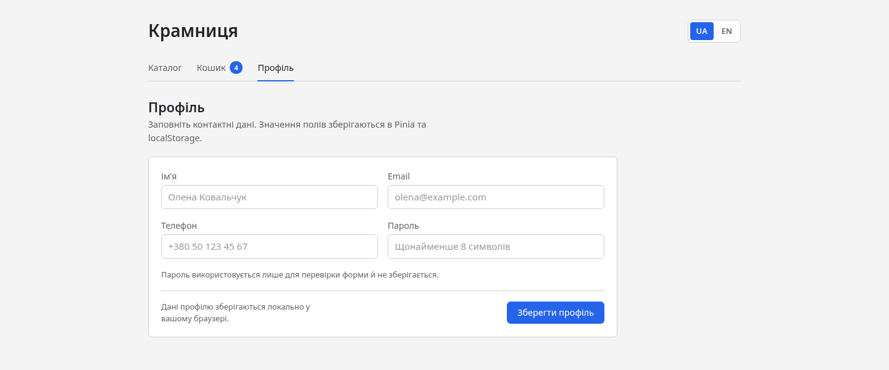
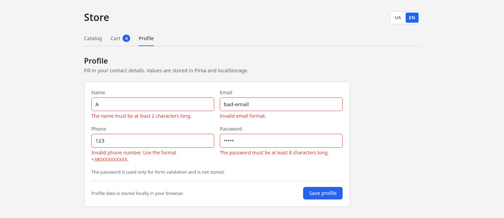

# Лабораторна робота №4 — Pinia та vue-i18n у Vue.js 3

Прототип інтернет-магазину на Vue 3.



## Запуск проєкту

Потрібні Node.js 20.19+ (або 22.12+) і pnpm.

```bash
cd lab4
pnpm install
pnpm dev
```

## Pinia: глобальний стан і персистентність

Ініціалізація у [main.js](src/main.js): `createPinia()`, `pinia.use(piniaPluginPersistedstate)`, `app.use(pinia)`. Після створення Pinia налаштування читаються до монтування застосунку, тому збережена мова одразу потрапляє в i18n.

| Стор       | Файл                                  | Стан                                                      | Гетери                     | Дії                                                      | Персистентність              |
| ---------- | ------------------------------------- | --------------------------------------------------------- | -------------------------- | -------------------------------------------------------- | ---------------------------- |
| `settings` | [settings.js](src/stores/settings.js) | `locale: 'ua' \| 'en'`, `profile: { name, email, phone }` | —                          | `setLocale(locale)`, `saveProfile(...)`                  | `persist: true` → `settings` |
| `cart`     | [cart.js](src/stores/cart.js)         | `items: Array<{ id, title, price, qty }>`                 | `totalCount`, `totalPrice` | `add(product)`, `decrement(id)`, `remove(id)`, `clear()` | `persist: true` → `cart`     |

Поле `title` у позиції кошика зберігає i18n-ключ (`products.mug.name`), а не знімок назви. Завдяки цьому назви товарів у кошику перекладаються під час перемикання мови.

## Локалізація (vue-i18n)

- У [i18n.js](src/i18n.js) створюється `createI18n({ locale: 'ua', fallbackLocale: 'ua', messages: { ua, en } })` у Composition-режимі (`legacy: false`).
- Ключі перекладів покривають заголовки, навігацію, кнопки, підказки, повідомлення про помилки, toast і назви/описи товарів.
- Стартова синхронізація: [main.js](src/main.js) встановлює `i18n.global.locale.value = settings.locale` до монтування. Далі [App.vue](src/App.vue) через `watch` тримає i18n, `document.documentElement.lang` і заголовок вкладки в актуальному стані.
- Плюралізація: для української додано власне правило `pluralRules.ua` (1 товар / 2–4 товари / 5+ товарів), тому лічильники в каталозі й кошику відмінюються правильно.
- Формати: у `numberFormats` описано формат `currency` для гривні. `useMoney()` викликає `n(value, 'currency', intlLocale)`, де код застосунку `ua` відображається на Intl-локаль `uk`.
- Символ `@` у перекладах є службовим для linked messages, тому email-плейсхолдер записано як `olena{'@'}example.com`.


## Скріншоти

Каталог англійською:



Кошик:



Профіль:



Локалізовані помилки валідації:


